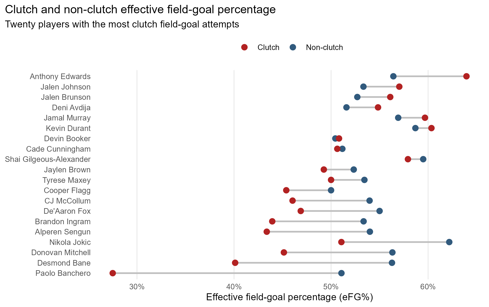
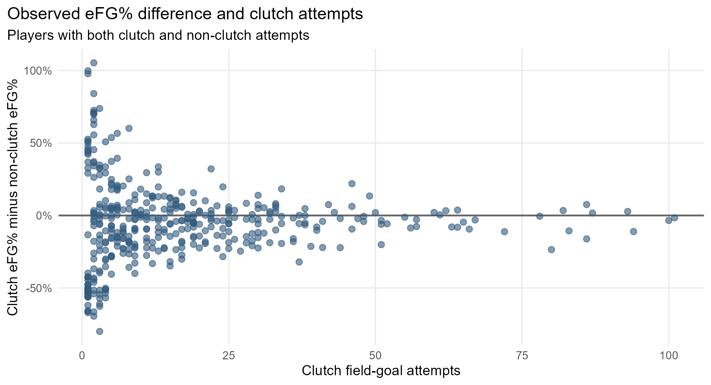

# Research Question

We ask whether NBA players have higher or lower effective field-goal percentages (eFG%) in clutch situations than in their own non-clutch situations during the 2025–26 regular season. We define clutch using the NBA standard: the final five minutes of the fourth quarter or overtime when the pre-shot scoring margin is five points or fewer. For each player $i$, our comparison is $\Delta_i = eFG_{i,\mathrm{clutch}} - eFG_{i,\mathrm{nonclutch}}$; our initial hypothesis is that the two underlying eFG% values are equal. We use eFG% rather than traditional FG% because it accounts for the additional value of made three-pointers, providing a more complete measure of shooting efficiency.

# Data

We obtained NBA play-by-play data for the completed 2025–26 regular season using the R package [hoopR](https://hoopr.sportsdataverse.org/reference/load_nba_pbp.html). Each record identifies the game and shooter and includes the period, game clock, team scores, shot value, and made/missed outcome needed to classify field-goal attempts; free throws were excluded. The available play-by-play covers 1,229 completed standard regular-season games. The exploratory analysis includes every player with at least one clutch and one non-clutch field-goal attempt; the first figure displays the 20 players with the most clutch attempts so that individual comparisons remain readable.

For our Bayesian analysis, we will use Beta-Binomial models to estimate four shooting probabilities per player: clutch and non-clutch two-point and three-point percentages. We will then use Monte Carlo simulation to draw from these posterior distributions and calculate clutch and non-clutch eFG%, weighting each shot type by its observed attempt frequency. Comparing the simulated eFG% values will allow us to estimate the posterior distribution of each player's clutch shooting difference, construct credible intervals, and calculate the probability that their clutch eFG% exceeds their non-clutch eFG%.

# Exploratory Analysis

Across the available games, 413 players attempted at least one clutch field goal. They combined for 7,138 clutch attempts. We calculate eFG% as $(FGM + 0.5 \times 3PM)/FGA$, accounting for the additional value of made three-pointers.

The first figure connects each player's non-clutch and clutch eFG%; points farther to the right represent higher observed shooting efficiency. The second figure displays each player's observed difference, $\widehat{\Delta}_i$, against the number of clutch attempts. Points above zero indicate a higher observed clutch eFG%, while points below zero indicate a lower observed eFG%. The attempt count shows how much clutch data supports each observed difference.

\newpage

{width=76% fig-align="center"}

{width=76% fig-align="center"}
